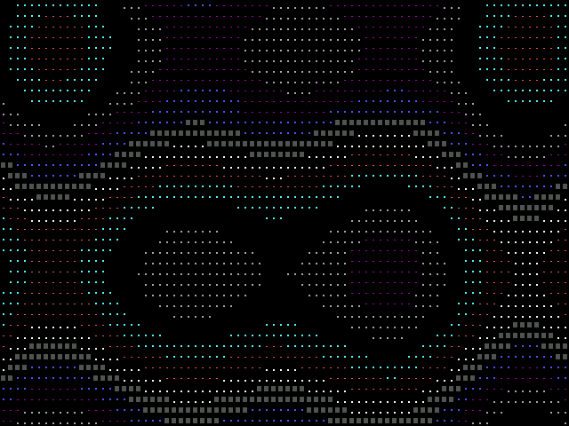
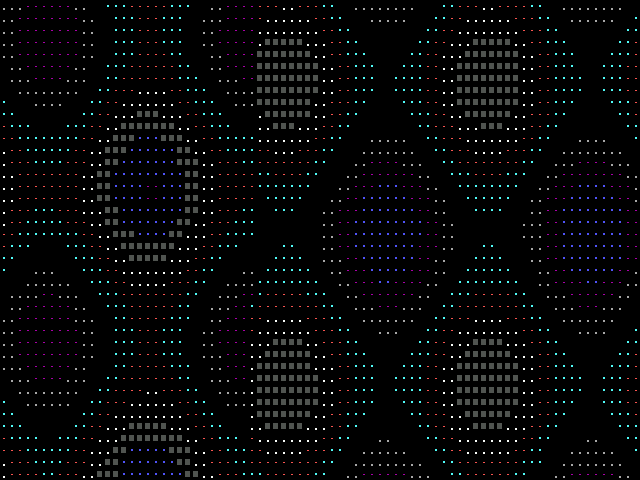

# Plasa Effect Demo for Zeal 8-bit Computer

This is a classic Plasma Effect Demo for Zeal 8-bit computer.  It was ported over from a demo for the C64.

This repo contains an implementation in both C and Z80 ASM

## Compiling

Use the current Zeal OS CMake toolchains through [ZDE](https://github.com/zoul0813/zeal-dev-environment):

```sh
zde deps install zvb
zde cmake
```

This builds both `bin/plasma.bin` (z88dk assembly) and `bin/plasmac.bin` (SDCC C).
Each variant has its own CMake build tree under `build/`, so their toolchains and
intermediate files do not conflict.

To build a single variant:

```sh
zde cmake build --target plasma
zde cmake build --target plasmac
```

## Screenshots

<figure>

<figcaption><i>Z80 ASM Plasma Demo</i></figcaption>
</figure>

<figure>

<figcaption><i>C Plasma Demo</i> - The C implementation is so slow, that you can see the rendering occur row by row.</figcaption>
</figure>

## CREDIT

Original Commodore 64 code obtained from [this video](https://www.youtube.com/watch?v=w93AncybKaY) by [Commodoreretro-programming](https://www.youtube.com/@Commodoreretro-programming) on YouTube.